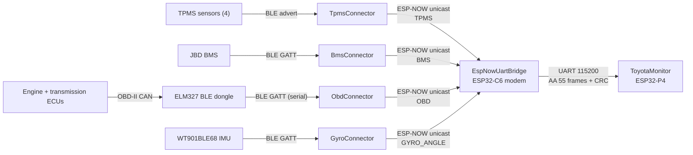

# Toyota Land Cruiser – architecture

The Toyota has one dashboard, ToyotaMonitor on an ESP32-P4 board. The P4 has no radio, so the ESP32-C6 on the same board runs an ESP-NOW modem (EspNowUartBridge) and passes every received packet to the P4 over UART. Connectors send their readings to the modem's MAC. The system is read-only: nothing is switched or controlled.

Concepts shared with the Volvo (ESP-NOW, packet contracts, vehicle profiles, flashing) are in the [main README](README.md). Addresses and TPMS sensor IDs for this vehicle are in [`src/Shared/Vehicles/Toyota.hpp`](src/Shared/Vehicles/Toyota.hpp).

## Topology

## Components

| Module | Board | Role | Inputs | Outputs |
| --- | --- | --- | --- | --- |
| [TpmsConnector](src/TpmsConnector/README.md) | ESP32 | TPMS gateway | BLE scan (`TPMS*` adverts) | ESP-NOW unicast to the modem |
| [BmsConnector](src/BmsConnector/README.md) | ESP32 | House battery gateway | BLE GATT to JBD BMS | ESP-NOW unicast to the modem |
| [ObdConnector](src/ObdConnector/README.md) | ESP32 | Transmission and boost readings | BLE ELM327 dongle | ESP-NOW unicast to the modem |
| [GyroConnector](src/GyroConnector/README.md) | ESP32 | Attitude gateway | BLE GATT to WT901 | ESP-NOW unicast to the modem |
| [EspNowUartBridge](src/EspNowUartBridge/README.md) | ESP32-C6 (on the P4 board) | ESP-NOW modem | ESP-NOW | UART to the P4 |
| [ToyotaMonitor](src/ToyotaMonitor/README.md) | ESP32-P4, 480×800 MIPI-DSI | Dashboard | UART from the modem | Display |

## Dashboard

ToyotaMonitor has three tabs and a status bar that is visible on every tab:

- **Gauges.** Four tyre pressure gauges with temperature, and the seconds since each sensor's last reading.
- **Tab2.** Pitch and roll indicators, driven by the gyro.
- **Transmission.** Current gear, torque converter lockup, ATF pan and outlet temperatures (orange from 105 °C, red from 115 °C), boost with a 0–2 bar bar, and MAP.
- **Status bar.** House battery values (V, A, SOC, Ah, °C), greyed out after 10 s without data, and four connector status lights: TPMS, OBD, BMS and GYRO. A light is grey before the first packet, green with a flash on each packet, and red when packets stop (15 s for TPMS and OBD, 10 s for BMS and gyro).

## Communication links

| Link | Transport | Addressing | Framing | Reliability |
| --- | --- | --- | --- | --- |
| TPMS sensors → TpmsConnector | BLE advertising (active scan) | Name prefix `TPMS` | Vendor advert, fixed offsets | 120 s scans restarted every 5 s |
| JBD BMS → BmsConnector | BLE GATT notify + write (FF00/FF01/FF02) | `Vehicle::BMS_BLE_MAC` (public) | JBD `DD … 77` frames | State machine, 5 s retry |
| ELM327 dongle → ObdConnector | BLE GATT serial service (auto-detected) | Name / known ELM service, or `Vehicle::OBD_DONGLE_MAC` | ELM327 text commands, `>` prompt | Rescan on disconnect; value cleared after 3 failed reads |
| Connectors → modem | ESP-NOW unicast | `Vehicle::DISPLAY_MAC`, `Vehicle::BMS_DEST_MAC` (both the modem) | Packed struct | Radio ACK; pings every 1–5 s |
| Modem → ToyotaMonitor | UART, 115200 8N1, C6 GPIO 16 TX → P4 GPIO 32 | Point to point | `AA 55` sync, kind, length, CRC-16 | CRC check; heartbeat every 1 s |

## Node addresses

From [`src/Shared/Vehicles/Toyota.hpp`](src/Shared/Vehicles/Toyota.hpp):

| Constant | MAC | Board |
| --- | --- | --- |
| `MODEM_MAC` (= `DISPLAY_MAC`, `BMS_DEST_MAC`) | 9C:13:9E:C3:FF:60 | EspNowUartBridge on the C6 |

| Sensor | Address / IDs |
| --- | --- |
| BMS | `A5:C2:37:2B:DC:A1` |
| Gyro (WT901BLE68) | `db:dd:a8:10:0b:fa` |
| OBD dongle | auto-detected (empty) |
| TPMS | 4 sensors: 7549971, 1126691, 14554163, 4592707 (gauge order) |

Physical boards and their board settings are listed in [`src/boards.json`](src/boards.json).

## Key data flows

1. **Tyre pressure.** TPMS advert → TpmsConnector parses it and increments `sequence` → ESP-NOW to the modem → UART → ToyotaMonitor stores the reading if `sequence` is higher than the last one. Every 5 s the connector repeats the last packet as a ping; before any sensor has been heard, the ping carries sensor ID 0, which the dashboard treats as "connected, no reading yet".
2. **OBD.** ObdConnector polls the ELM327: `21DA` (gear, lockup) and `010B` (MAP) every cycle, `21D9` (ATF temperatures) every 2 s, `0133` (barometric pressure) every 30 s. It sends an `ObdPacket` up to 4 times a second, and about once a second while it searches for the dongle or the vehicle doesn't answer, with a status field saying which.
3. **Battery.** BMS polled every 1 s → `BmsPacket` every 1 s → status bar.
4. **Modem health.** The modem sends a heartbeat every second with its MAC and receive counters. The dashboard logs `ESP-NOW modem up` / `ESP-NOW modem lost`, and every 10 s the modem's receive and drop counts.

## Known issues

- **Gear and lockup decoding is unverified** on the 2008 VDJ200 (`21DA`, bits taken from related Toyota gearboxes). The gear tile shows the raw code. See [`src/Toyota Techstream PIDs.pdf`](src/Toyota%20Techstream%20PIDs.pdf).
- **One TPMS sequence for all sensors.** If TpmsConnector reboots while the dashboard stays on, its sequence restarts at 1 and readings are ignored until the dashboard restarts too.
- **Opening the P4's USB serial port resets it**, which clears the readings shown on the dashboard.
