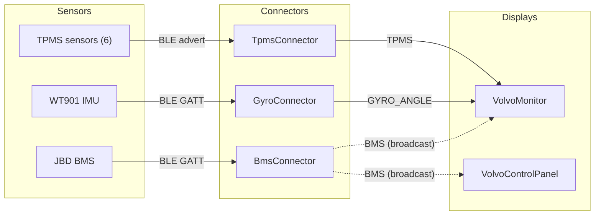
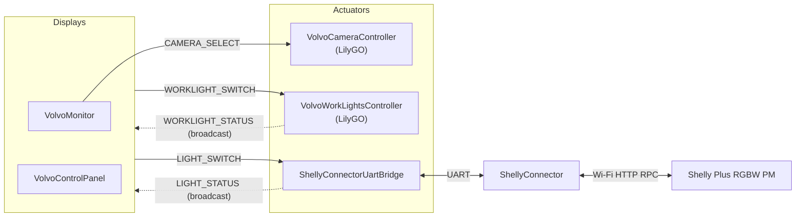
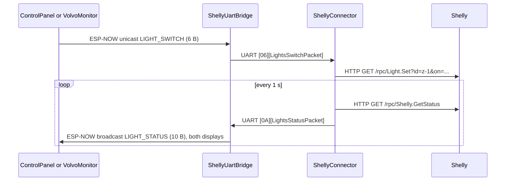

# Volvo camper – architecture

The Volvo runs two touchscreens, three sensor connectors and four actuator boards, all on ESP-NOW. Sensor data flows into the displays; light and camera commands flow from the displays to the actuators. The one exception is the Shelly light controller, reached over Wi-Fi through a pair of boards joined by UART.

Concepts shared with the Toyota (ESP-NOW, packet contracts, vehicle profiles, flashing) are in the [main README](README.md). Addresses and TPMS sensor IDs for this vehicle are in [`src/Shared/Vehicles/Volvo.hpp`](src/Shared/Vehicles/Volvo.hpp).

## Topology

### Sensor data

Connectors read third-party sensors over BLE and send the readings to the displays over ESP-NOW.

Solid ESP-NOW arrows are unicast; dotted arrows are broadcasts.

### Control

Both displays switch the interior (Shelly) and exterior (work lights) lights; VolvoMonitor also selects the camera. Commands are unicast. Status comes back as broadcasts that both displays receive, so a change made on one display shows up on the other.

## Components

| Module | Board | Role | Inputs | Outputs |
| --- | --- | --- | --- | --- |
| [TpmsConnector](src/TpmsConnector/README.md) | ESP32 | TPMS gateway | BLE scan (`TPMS*` adverts) | ESP-NOW unicast to VolvoMonitor |
| [GyroConnector](src/GyroConnector/README.md) | ESP32 | Attitude gateway | BLE GATT to WT901 | ESP-NOW unicast to VolvoMonitor |
| [BmsConnector](src/BmsConnector/README.md) | ESP32 | House battery gateway | BLE GATT to JBD BMS | ESP-NOW broadcast to both displays |
| [VolvoMonitor](src/VolvoMonitor/README.md) | ESP32-S3, 480×800 | Dashboard: tyres, attitude, power, camera | ESP-NOW | ESP-NOW unicast commands |
| [VolvoControlPanel](src/VolvoControlPanel/README.md) | ESP32-S3 Waveshare RGB LCD | Camper control panel: battery, lights | ESP-NOW | ESP-NOW unicast commands; power relay (GPIO 6) |
| [VolvoCameraController](src/VolvoCameraController/README.md) | LilyGO, 4 relays | Camera input selector | ESP-NOW | 4 relays |
| [VolvoWorkLightsController](src/VolvoWorkLightsController/README.md) | LilyGO, 4 relays | Exterior work lights | ESP-NOW, 4 buttons | 4 relays; ESP-NOW broadcast status |
| [ShellyConnectorUartBridge](src/ShellyConnectorUartBridge/README.md) | ESP32 | ESP-NOW side of the Shelly path | ESP-NOW | UART |
| [ShellyConnector](src/ShellyConnector/README.md) | ESP32 | Shelly client | UART | Wi-Fi HTTP RPC |

## Power

Two relays gate power to the headless ESP boards:

- **Control panel sleep.** After 60 s without a touch, VolvoControlPanel turns off its backlight, shuts down ESP-NOW and drives GPIO 6 low, which cuts power to the boards behind that relay. A touch reverses all three steps; ESP-NOW is restarted before the boards are powered back on.
- **Ignition.** The second relay follows the ignition switch, so VolvoMonitor can switch the lights only with the ignition on.

The camera LilyGO (VolvoCameraController) is still powered constantly and will move to ignition-switched power.

## Communication links

| Link | Transport | Addressing | Framing | Reliability |
| --- | --- | --- | --- | --- |
| TPMS sensors → TpmsConnector | BLE advertising (active scan) | Name prefix `TPMS` | Vendor advert, fixed offsets | 120 s scans restarted every 5 s |
| WT901 → GyroConnector | BLE GATT notify + write (FFE5/FFE4/FFE9) | `Vehicle::GYRO_BLE_MAC` (random) | WitMotion 20-byte frames, `0x55` sync | Reconnect in `loop()` |
| JBD BMS → BmsConnector | BLE GATT notify + write (FF00/FF01/FF02) | `Vehicle::BMS_BLE_MAC` (public) | JBD `DD … 77` frames | State machine, 5 s retry |
| TpmsConnector, GyroConnector → VolvoMonitor | ESP-NOW unicast | `Vehicle::DISPLAY_MAC` | Packed struct | Radio ACK; TPMS re-sent every 5 s |
| BmsConnector → both displays | ESP-NOW broadcast | `Vehicle::BMS_DEST_MAC` = broadcast | Packed struct | Re-sent every 1 s |
| VolvoMonitor → camera controller | ESP-NOW unicast | `LILYGO_CAMERA_MAC` | Packed struct | `espnow_retry`, up to 5 retries |
| Displays → work lights, Shelly bridge | ESP-NOW unicast | `LILYGO_WORKLIGHT_MAC`, `SHELLY_BRIDGE_MAC` | Packed struct | `espnow_retry`, up to 5 retries |
| Work lights, Shelly bridge → displays | ESP-NOW broadcast | `FF:FF:FF:FF:FF:FF` | Packed struct | Periodic (5 s / 1 s) |
| Shelly bridge ↔ ShellyConnector | UART1, 115200 8N1, GPIO 16 RX / 17 TX | Point to point | `[len:1][struct]` | Length-based resync, 50 ms frame timeout |
| ShellyConnector ↔ Shelly | Wi-Fi STA + HTTP GET RPC | `192.168.33.1` | JSON | Reconnect; reboot on failure |

## Node addresses

From [`src/Shared/Vehicles/Volvo.hpp`](src/Shared/Vehicles/Volvo.hpp):

| Constant | MAC | Board |
| --- | --- | --- |
| `DISPLAY_MAC` | 50:78:7D:13:22:F8 | VolvoMonitor (5" S3); destination of TPMS and gyro packets |
| `S3_7_INCH_MAC` | D0:CF:13:06:79:A0 | 7" S3 display; not referenced by any sketch |
| `LILYGO_CAMERA_MAC` | 94:51:DC:47:AE:C4 | VolvoCameraController |
| `LILYGO_WORKLIGHT_MAC` | E0:8C:FE:75:DA:54 | VolvoWorkLightsController |
| `SHELLY_BRIDGE_MAC` | D4:E9:F4:A8:7E:34 | ShellyConnectorUartBridge |

| Sensor | Address / IDs |
| --- | --- |
| BMS | `A5:C2:37:62:EF:6E` |
| Gyro (WT901) | `e0:3b:b5:fe:27:8e` |
| TPMS | 6 sensors: 8924691, 9580339, 9449267, 6499363, 14692163, 2240579 (gauge order) |

## Key data flows

### Interior light toggle (the longest path)

The first UART byte wakes the ShellyConnector from light sleep. It discards what woke it and then joins the Shelly's Wi-Fi, so the command that caused the wake-up is lost. Neither display waits for a reply: each flips its button at once and corrects it when the next status broadcast arrives.

### Other flows

1. **Tyre pressure.** TPMS advert → TpmsConnector parses it and increments `sequence` → ESP-NOW unicast to VolvoMonitor. The monitor stores a reading only if `sequence` is higher than the last one, so the 5 s re-sends are ignored.
2. **Attitude.** WT901 notify frames → GyroConnector → `GyroAnglePacket` at most once a second → VolvoMonitor. The monitor converts centi-degrees to degrees and turns yaw into a compass heading, `(360 - yaw + 90) % 360`.
3. **Battery.** BMS polled every 1 s → `BmsPacket` broadcast every 1 s → both displays update SOC, Ah and current.
4. **Camera.** A tap on the monitor's Camera tab → `CameraSelectPacket` unicast with retries → the LilyGO energises one of 4 relays. At boot the monitor selects input 1 (rear high).
5. **Work lights.** A toggle on either display, or a physical button → relay change → `WorkLightsStatusPacket` broadcast, immediately after a button press and every 5 s → the exterior toggles on both displays follow. A toggle on one display shows up on the other within 5 s.

## Known issues

- **No authentication or encryption.** Any nearby device can inject a `CAMERA_SELECT` or `LIGHT_SWITCH` packet. VolvoCameraController does not even check `type` or `len`.
- **Gyro height units.** `GyroAnglePacket.height` is filled with whole metres, but the comment says centimetres.
- **Unused items.** `TYPE_SHELLY_BRIDGE_KEEPALIVE`, `WakeUpPacket`, `S3_7_INCH_MAC`, and the Shelly bridge's `bridgeEnabled` / `KEEPALIVE_TIMEOUT_MS`.
- **Board settings.** The Volvo entries in [`src/boards.json`](src/boards.json) have no `fqbn` yet. VolvoMonitor needs a larger app partition than the 1.25 MB default.
